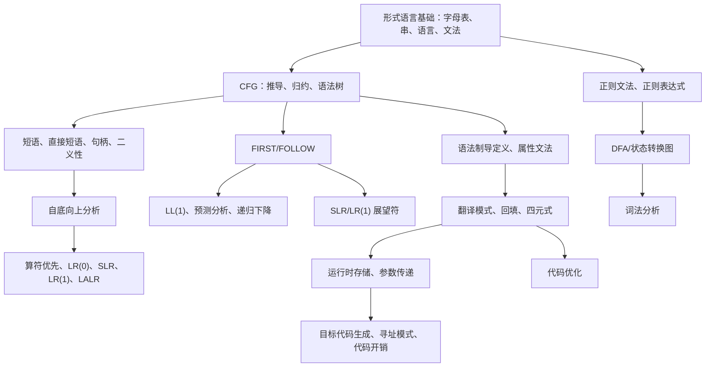

# 编译原理知识清单

整理依据：本目录中的 `2024年秋编译原理期末考试试题（回忆版）.pdf`、`2026春编译原理-作业1.pdf`、`2026编译原理-作业2.pdf`、各 chapter 课件与自学课件。

复习优先级：

- **最重要**：往年考试和两次作业直接涉及的知识。先保证这些题型会做、步骤会写。
- **中等重要**：课件例题涉及但作业/往年卷未直接大题化的知识。适合用来补选择、判断、填空和变形题。
- **次等重要**：课件中出现但当前材料中题目覆盖较少的知识。用于补概念面，不建议在时间紧张时深挖。

## 依赖关系总图



## 一、最重要：考试与作业涉及的知识

### 1. 编译器总体结构与基本概念

来源：作业一第一章；往年卷选择、判断。

依赖：无，是后续章节的术语基础。

必会：

- **源程序**：用源语言写成的程序。
- **目标程序**：翻译后得到的目标语言程序，通常是汇编或机器语言。
- **翻译程序**：把一种语言程序转换为另一种语言程序的程序。
- **编译程序**：整体翻译源程序，生成目标程序。
- **解释程序**：边分析边执行，不以生成独立目标程序为主要目标。
- 典型编译器阶段：词法分析、语法分析、语义分析、中间代码生成、代码优化、目标代码生成。
- 符号表管理和出错处理贯穿多个阶段。
- 有些课件把“语义分析与中间代码生成”合并讲。考试遇到“前三个阶段”时，优先按课件语境判断：词法、语法、语义；若选项把语义和中间代码生成绑定，也要留意。

典型考题与解析：

- **题型：解释概念并比较编译与解释。**
  解析：编译强调“先翻译成目标程序，再运行”；解释强调“运行时逐句/逐结构分析执行”。二者都属于翻译思想，但输出形态和执行时机不同。

- **题型：画编译器结构框图。**
  答题骨架：源程序 -> 词法分析 -> 语法分析 -> 语义分析 -> 中间代码生成 -> 代码优化 -> 目标代码生成 -> 目标程序。侧边画“符号表管理”“出错处理”连接各阶段。

- **题型：T 形图/交叉编译。**
  作业模型：A 机已有 C 编译器，且有用 C 写的 NEW 编译器源程序。先用 A 机 C 编译器编译 NEW 编译器源程序，得到“运行在 A、生成某目标机代码”的 NEW 编译器。若要得到运行在 B 的 NEW 编译器，需要能生成 B 机代码的交叉编译条件，或先有能在 A 上生成 B 目标代码的 C/NEW 编译链。

### 2. 文法基础：CFG、推导、归约、句型、语法树

来源：作业一第二章；往年卷选择、填空、综合题。

依赖：形式语言基础。

必会：

- 文法四元组：`G=(V,T,P,S)`。`P` 是产生式集合。
- 从开始符号经零步或多步推导得到的文法符号串是**句型**；全由终结符组成的句型是**句子**。
- 最左推导：每步替换最左非终结符。
- 最右推导：每步替换最右非终结符。
- 规范推导：通常指**最右推导**。
- 规范归约：是规范推导的逆过程，按句柄进行归约，常表述为**最左归约**。
- 乔姆斯基文法分类：0 型短语文法、1 型上下文有关文法、2 型上下文无关文法、3 型正则文法。

典型考题与解析：

- **题型：给文法和句子，写最左/最右推导并画语法树。**
  作业模型：
  `程序 -> 分程序 | 复合语句` 等，句子为 `L : begin d ; d ; s ; s end`。
  解题步骤：
  1. 先看最外层是否带标号。这里以 `L :` 开头，应选 `标号 : 分程序` 或 `标号 : 复合语句`。
  2. `begin d ; d ; s ; s end` 中有说明序列 `d ; d`，所以走“分程序”分支。
  3. 最左推导每次替换最左非终结符；最右推导每次替换最右非终结符。
  4. 语法树根为开始符号，内部结点为非终结符，叶子从左到右拼成原句子。

- **题型：判断某符号串是句型还是句子。**
  解析：含非终结符但可由开始符号推导得到的是句型；全是终结符才是句子。

### 3. 短语、直接短语、素短语、句柄、二义性

来源：往年卷选择、判断、综合题；chapter2、chapter5 例题。

依赖：CFG、语法树、推导/归约。

必会：

- 短语：某棵子树全部叶子从左到右形成的串。
- 直接短语：只含父子两代的子树的叶子串。
- 句柄：规范句型中的最左直接短语，是自底向上分析当前应归约的对象。
- 素短语：至少含一个终结符，且不再包含更小素短语的短语。
- 二义性文法：同一句子有两棵不同语法树，或有不同最左/最右推导。

典型考题与解析：

- **往年卷模型：**
  文法：
  ```text
  S -> a A c B e
  A -> A b | b
  B -> d
  ```
  句子 `abbcde` 的推导：
  ```text
  S => a A c B e
    => a A b c B e
    => a b b c B e
    => a b b c d e
  ```
  最左直接短语是第一个 `b`，因为内层 `A -> b` 最先形成可归约的两代子树。句型 `aAbcde` 中常见短语包括 `Ab`、`d`、`aAbcde`；直接短语为 `Ab` 和 `d`。若老师按“叶子非终结符也可作零步短语”约定，`A` 也可能被列出，答题时最好写清依据。

- **判断陷阱：**
  “最左素短语是处于句型最左边的那个短语”是错的。它必须先是素短语，不是任意短语。

- **选择陷阱：**
  对表达式文法，句柄不是“看起来最长”的片段，而是当前规范句型里可按产生式右部归约的最左直接短语。

### 4. 正则表达式、正则文法、DFA 与词法分析

来源：作业一第三章；往年卷综合题；chapter3 例题。

依赖：字母表、串、语言；DFA 五元组。

必会：

- DFA 五元组：`M=(Q,Σ,δ,q0,F)`。
- DFA 设计要点：状态含义要清楚；每个状态对字母表中每个符号都应有确定转移；终态代表“到目前为止已接受”。
- 正则表达式常用运算：并 `|`、连接、闭包 `*`、正闭包 `+`。
- 词法分析器输入源程序字符流，输出 token 序列；常处理空白/注释、常数值转换、标识符和关键字识别。

典型考题与解析：

- **往年卷模型：文件名 `device:filename:extension`。**
  若 `letter` 表示字母，则正则表达式：
  ```text
  letter+ : letter+ : letter+
  ```
  DFA 状态含义：
  - `q0`：尚未读入 device。
  - `q1`：正在读 device，至少一个字母。
  - `q2`：读到第一个冒号，准备读 filename。
  - `q3`：正在读 filename，至少一个字母。
  - `q4`：读到第二个冒号，准备读 extension。
  - `q5`：正在读 extension，至少一个字母，终态。
  非法字符或提前结束进入死状态。

- **作业模型：LABEL 标号说明。**
  文法语言可写为：
  ```text
  LABEL d+ (, d+)* ;
  ```
  其中 `d+` 表示一位或多位数字。DFA 可把关键字 `LABEL` 压缩为一个整体，也可逐字符画出 `L -> A -> B -> E -> L` 的状态链；考试中若题干把 `LABEL` 作为终结符，压缩画法可接受。

- **课件常见 DFA 设计模型：**
  - 以 `00` 结尾：状态记录“末尾是否已有一个 0/两个 0”。
  - 包含/不包含某子串：先画“包含”的主线，再用补集交换终态。
  - 奇偶个数：状态记录模 2。
  - 二进制数被 3 整除：状态记录当前值 mod 3，读入 `0/1` 后按 `(2r+b) mod 3` 转移。

### 5. LL(1)、FIRST/FOLLOW、预测分析、递归下降

来源：作业一第四章；往年卷计算题；chapter4 例题。

依赖：CFG、消除左递归、提取左公因子、FIRST/FOLLOW。

必会：

- 普通 FIRST：能从符号串开头推出的终结符集合；可空则含 `ε`。
- FOLLOW(A)：在某句型中可紧跟在 `A` 右侧的终结符集合；开始符号含 `#`。
- LL(1) 条件：同一非终结符的候选式 FIRST 两两不交；若某候选可空，则其余候选的 FIRST 与该非终结符 FOLLOW 不交。
- 预测分析表构造：
  - 对 `A -> α`，把它填入 `FIRST(α)-{ε}` 对应列。
  - 若 `ε ∈ FIRST(α)`，还要填入 `FOLLOW(A)` 对应列。
- 递归下降：每个非终结符写一个过程；根据 lookahead 选择产生式。

典型考题与解析：

- **作业模型：**
  ```text
  S -> S a A | b A
  A -> c A | d
  ```
  消除左递归：
  ```text
  S  -> b A S'
  S' -> a A S' | ε
  A  -> c A | d
  ```
  集合：
  ```text
  FIRST(S)  = { b }
  FIRST(S') = { a, ε }
  FIRST(A)  = { c, d }
  FOLLOW(S)  = { # }
  FOLLOW(S') = { # }
  FOLLOW(A)  = { a, # }
  ```
  预测分析表关键项：
  ```text
  M[S, b]   = S -> b A S'
  M[S', a]  = S' -> a A S'
  M[S', #]  = S' -> ε
  M[A, c]   = A -> c A
  M[A, d]   = A -> d
  ```
  输入 `bccdad` 可按表推出：
  ```text
  S => b A S'
    => b c A S'
    => b c c A S'
    => b c c d S'
    => b c c d a A S'
    => b c c d a d S'
    => b c c d a d
  ```

- **作业模型：布尔表达式改写为 LL(1)。**
  原文法：
  ```text
  B -> B ∨ T | T
  T -> T ∧ F | F
  F -> ¬ F | (B) | true | false
  ```
  改写：
  ```text
  B  -> T B'
  B' -> ∨ T B' | ε
  T  -> F T'
  T' -> ∧ F T' | ε
  F  -> ¬ F | ( B ) | true | false
  ```
  这个结构同时保留优先级：`¬` 高于 `∧`，`∧` 高于 `∨`。

- **往年卷模型：**
  ```text
  S -> S O S | (S) | id
  O -> * | +
  ```
  消除直接左递归：
  ```text
  S  -> ( S ) S' | id S'
  S' -> O S S' | ε
  O  -> * | +
  ```
  FIRST：
  ```text
  FIRST(S)  = { (, id }
  FIRST(S') = { *, +, ε }
  FIRST(O)  = { *, + }
  ```
  FOLLOW：
  ```text
  FOLLOW(S)  = { #, ), *, + }
  FOLLOW(S') = { #, ), *, + }
  ```
  判断：不是 LL(1)。原因是 `S' -> O S S' | ε` 中，`FIRST(O S S')={*,+}`，而 `FOLLOW(S')` 也含 `{*,+}`，预测分析表冲突。

### 6. 算符优先分析与 FIRSTVT/LASTVT

来源：往年卷选择；chapter5 例题。

依赖：自底向上分析、短语/句柄、表达式文法。

必会：

- 有些课件把 `FIRSTVT/LASTVT` 写作 `FIRSTOP/LASTOP`。它不同于普通 FIRST。
- `FIRSTVT(A)` 规则：
  - 若 `A -> a...`，把 `a` 加入。
  - 若 `A -> B a...`，把 `a` 加入。
  - 若 `A -> B...`，把 `FIRSTVT(B)` 加入。
- `LASTVT(A)` 类似，关注右端最后或倒数第二的终结符。
- 算符优先关系：
  - `a =· b`：产生式右部相邻出现 `ab`，或 `a B b`。
  - `a <· b`：出现 `a B`，且 `b ∈ FIRSTVT(B)`。
  - `a >· b`：出现 `B b`，且 `a ∈ LASTVT(B)`。

典型考题与解析：

- **往年选择模型：**
  ```text
  S -> T | S ∨ T
  T -> U | T ∧ U
  U -> i | - U
  ```
  若题目沿用算符优先中的 `FIRSTOP/FIRSTVT`，则：
  ```text
  FIRSTVT(U) = { i, - }
  FIRSTVT(T) = { ∧, i, - }
  FIRSTVT(S) = { ∨, ∧, i, - }
  ```
  不要误作普通 FIRST。普通 `FIRST(S)` 才是 `{i, -}`。

### 7. LR(0)、SLR(1)、LR(1)、LALR(1)

来源：作业二第五章；往年卷选择、计算题；chapter5 大量例题。

依赖：自底向上分析、句柄、项目、CLOSURE/GOTO、FIRST。

必会：

- 项目：
  - `A -> α · a β`：点后是终结符，常是移进项目。
  - `A -> α · B β`：点后是非终结符，常称待约项目，需要展开 `B`。
  - `A -> α ·`：归约项目。
  - `S' -> S ·`：接受项目。
- LR(1) 项目形如 `[A -> α · β, a]`，`a` 是展望符。
- `CLOSURE(I)`：若项目点后为非终结符 `B`，对每个 `B -> γ` 和 `b ∈ FIRST(βa)` 加入 `[B -> ·γ, b]`。
- `GOTO(I,X)`：把 `I` 中点后为 `X` 的项目越过 `X`，再求闭包。
- ACTION/GOTO 表：
  - 点后终结符 `a` 且 `goto(I,a)=J`：`ACTION[I,a]=shift J`。
  - `[A -> α·, a]`：`ACTION[I,a]=reduce A -> α`。
  - `[S' -> S·, #]`：接受。
  - 点后非终结符 `A`：填 `GOTO`。

典型考题与解析：

- **作业模型：**
  ```text
  S -> A
  A -> B A | ε
  B -> a B | c
  ```
  语言是若干个 `a* c` 串的连接，也允许空串。输入 `acac` 可分解为 `B B`，其中每个 `B => a c`。
  LR(1) 分析时最容易错的是 `A -> ε` 的展望符：只有在展望符允许结束一个 `A` 时才归约为空。对 `acac` 的归约骨架：
  ```text
  c       -> B
  a B     -> B
  c       -> B
  a B     -> B
  ε       -> A
  B A     -> A
  B A     -> A
  A       -> S
  accept
  ```

- **往年卷 LR(1) 模型：**
  ```text
  S' -> S
  S  -> V = E | E
  V  -> * E | id
  E  -> V
  ```
  这个文法的关键是：状态中 `E -> V ·` 的展望符若只有 `$`，则在看到 `=` 时不归约，而应移进。LR(1) 用展望符解决了 SLR 中可能出现的冲突。

  一组 LR(1) 项目集骨架：
  ```text
  I0:
    S' -> · S, $
    S  -> · V = E, $
    S  -> · E, $
    E  -> · V, $
    V  -> · * E, $ / =
    V  -> · id, $ / =
    goto: *->I1, id->I2, E->I3, V->I4, S->I5

  I4:
    S -> V · = E, $
    E -> V ·, $
    on '=' shift; on '$' reduce E -> V

  I8:
    S -> V = · E, $
    E -> · V, $
    V -> · * E, $
    V -> · id, $
  ```
  答题时不一定要背状态编号，但必须写出 `closure` 中展望符如何传递，并在分析表中体现“`=` 移进、`$` 归约”的差别。

### 8. 语法制导定义、属性文法、翻译模式

来源：作业二未单独设题但往年卷选择、填空、综合题；chapter6 例题。

依赖：语法树、属性、语义规则。

必会：

- 综合属性：由子结点或自身信息计算，常自底向上。
- 继承属性：由父结点或左兄弟传入，常自顶向下或从左到右。
- S 属性定义：只含综合属性。
- L 属性定义：继承属性只能依赖父结点继承属性和左侧兄弟属性。
- 翻译模式：把语义动作插入产生式右部，动作位置必须满足属性可用性。

典型考题与解析：

- **往年选择模型：**
  语义规则：
  ```text
  B1.ps = B.ps
  B2.ps = 0.65 * B.ps
  B.dp = max(B1.dp, B2.dp + 0.35 * B.ps)
  ```
  `ps` 从父结点 `B` 传给子结点 `B1/B2`，是继承属性；`dp` 由子结点计算给父结点，是综合属性。

- **往年填空模型：中缀转后缀。**
  ```text
  E -> T R
  R -> + T {print +} R1 | ε
  T -> num {print num.val}
  ```
  输入 `5+6+7` 的输出：
  ```text
  5 6 + 7 +
  ```
  因为每读到一个 `num` 先打印数值，每匹配一个 `+T` 后打印 `+`。

- **往年综合模型：while-do 最大嵌套层数。**
  对文法：
  ```text
  S -> E
  E -> while E1 do E2
  E -> id := E1
  E -> id
  E -> E1 + E2
  E -> (E1)
  ```
  可用综合属性 `loop`：
  ```text
  S -> E                 { print(E.loop) }
  E -> while E1 do E2    { E.loop = max(E1.loop, E2.loop) + 1 }
  E -> id := E1          { E.loop = E1.loop }
  E -> id                { E.loop = 0 }
  E -> E1 + E2           { E.loop = max(E1.loop, E2.loop) }
  E -> (E1)              { E.loop = E1.loop }
  ```
  如果老师定义“条件表达式中的 while 不算循环体嵌套”，则第一条可能写作 `max(E1.loop, E2.loop + 1)`；一般按语法嵌套理解，用 `max(...)+1` 更自然。

### 9. 中间代码、四元式、布尔表达式与回填

来源：作业二第七章；往年卷填空、综合题、名词解释；chapter7 例题。

依赖：三地址码、布尔表达式短路翻译、语法制导翻译。

必会：

- 三地址码：每条指令最多两个操作数和一个结果。
- 四元式一般形如 `(op, arg1, arg2, result)`。
- 常见指令：
  - `x := y op z`
  - `goto L`
  - `if x relop y goto L`
  - `param x`
  - `call p, n`
  - `return y`
  - `x := y[i]`、`x[i] := y`
  - `x := &y`、`x := *y`、`*x := y`
- 回填：先生成目标地址未知的跳转指令，把这些指令编号放入链表；等目标地址确定后再统一填入。

典型考题与解析：

- **往年填空模型：while 回填。**
  ```text
  S -> while M1 B do M2 S1
  {
      backpatch(S1.nextlist, M1.quad);
      backpatch(B.truelist, M2.quad);
      S.nextlist := B.falselist;
      gencode('goto', M1.quad);
  }
  ```
  解释：条件真跳到循环体；循环体执行完跳回条件；条件假成为整个 while 的出口。

- **作业模型：翻译 while/if 嵌套为四元式。**
  对
  ```text
  while x < z ∧ y < t do
      if x = 0 then z := z - 1
      else while x <= t do x := x + 3
  ```
  解题步骤：
  1. 先给每个布尔条件生成条件跳转和无条件跳转。
  2. `∧` 用短路：`x<z` 真才继续测 `y<t`，否则直接到 while 出口。
  3. `if-then-else`：真链回填到 then 入口，假链回填到 else 入口；then 结束要跳过 else。
  4. 内层 while 的假出口回到外层循环体之后，外层循环体末尾跳回外层条件开始。
  5. 四元式编号必须连续，所有 `goto _` 最后回填。

- **名词解释：回填。**
  标准答法：在单遍生成中间代码时，某些跳转目标尚未确定，先把待填目标的指令编号串成链表；目标地址确定后调用 `backpatch` 把同一链表中的目标域填成该地址。

### 10. 过程调用、参数传递、静态链/动态链

来源：作业二第九章；往年卷填空、名词解释；chapter911 与 chapter9。

依赖：中间代码、运行时存储、活动记录。

必会：

- 过程活动：过程体一次执行对应一个活动。
- 活动记录：一次过程活动所需的运行时存储区，常含返回地址、动态链、静态链、形式单元、局部变量、临时变量等。
- 动态链：指向调用该过程前最新活动记录的指针，用于恢复调用链。
- 静态链：指向静态直接外层过程的最新活动记录，用于访问非局部变量。
- 参数传递：
  - 传值：传右值，形参改变不影响实参。
  - 传地址：传左值/地址，形参间接访问实参。
  - 传值结果：入口复制值，返回时复制回实参地址。
  - 传名：用形实转换子程序 thunk 模拟文字替换。

典型考题与解析：

- **往年填空模型：**
  三地址码：
  ```text
  param x1
  param x2
  ...
  param xn
  call p, n
  ```
  对第 `i` 个实参：
  ```text
  传值：   (i+3)[top] := xi
  传地址： (i+3)[top] := addr(xi)
  ```
  所以翻译 `param xn` 时：
  ```text
  传值：   (n+3)[top] := xn
  传地址： (n+3)[top] := addr(xn)
  ```

- **名词解释：静态链/动态链。**
  动态链看运行时“谁调用我”；静态链看源程序“谁在词法上包围我”。一句话区分：动态链服务返回和活动记录恢复，静态链服务非局部变量访问。

### 11. 存储对齐、结构体大小

来源：作业二第九章。

依赖：类型宽度、地址偏移、对齐规则。

必会：

- 每个字段起始地址要满足自身对齐。
- 结构体总大小通常要补齐到最大成员对齐的倍数。

典型考题与解析：

```c
typedef struct {
    short i; short j; long k;
} a;

typedef struct {
    short i; long j; short k;
} b;
```

已知 `short` 大小 2、按 2 对齐；`long` 大小 4、按 4 对齐。

- `a`：
  - `i` offset 0，占 0-1。
  - `j` offset 2，占 2-3。
  - `k` offset 4，占 4-7。
  - 总大小 8。
- `b`：
  - `i` offset 0，占 0-1。
  - 为让 `j` 按 4 对齐，offset 2-3 填充。
  - `j` offset 4，占 4-7。
  - `k` offset 8，占 8-9。
  - 结构体总大小需为最大对齐 4 的倍数，offset 10-11 再填充。
  - 总大小 12。

### 12. 目标代码、寻址模式、指令开销

来源：作业二第十一章；往年卷填空；chapter911 与 chapter11。

依赖：三地址码、目标机器模型、寻址模式。

必会：

- 指令开销：
  ```text
  指令开销 = 1 + 源操作数寻址附加开销 + 目的操作数寻址附加开销
  ```
- 寻址附加开销：
  ```text
  M       绝对地址      1
  R       寄存器        0
  c(R)    下标          1
  *R      间址寄存器    0
  *c(R)   间址下标      1
  #c      直接量        1
  ```

典型考题与解析：

- **往年填空：`mov a, R1` 的开销。**
  `a` 是绝对地址，附加开销 1；`R1` 是寄存器，附加开销 0：
  ```text
  1 + 1 + 0 = 2
  ```

- **作业模型：计算指令序列开销。**
  ```text
  MOV m, R0     2
  MOV n, R1     2
  ADD R1, R0    1
  MOV R0, t     2
  合计          7
  ```
  ```text
  MOV j, R0       2
  MUL 4, R0       2
  MOV c(R0), R1   2
  MOV R1, d       2
  合计            8
  ```
  ```text
  MOV q, R0       2
  MOV 4(R0), R1   2
  MOV R1, u       2
  合计            6
  ```
  ```text
  MOV u, R0       2
  MOV v, R1       2
  SUB R1, R0      1
  MOV R0, *R2     1
  合计            6
  ```

## 二、中等重要：课件例题涉及的知识

### 1. 字母表、字符串、语言及其运算

来源：chapter2-0 例题。

依赖：无。

必会：

- 字母表 `Σ`：符号的有限集合。
- 串：字母表符号组成的有限序列；空串 `ε`。
- `Σ*`：包括空串的所有串；`Σ+`：不含空串的所有非空串。
- 语言：`Σ*` 的任意子集。
- 语言运算：并、连接、幂、闭包。

典型考法：

- 给 `Σ={0,1}`，写出 `Σ0、Σ1、Σ2、Σ*` 的部分元素。
- 给 `L={001,10,111}`、`M={ε,001}`，求 `L∪M`、`LM`、`L*` 的若干元素。

### 2. 非上下文无关语言的直觉

来源：chapter2-1 例题。

必会：

- `L={wcw | w∈{a,b}+}` 常用于抽象“声明与引用一致”，不是 CFG 能完整描述的典型结构。
- `L={a^n b^m c^n d^m | n,m≥0}` 抽象参数个数匹配等上下文相关约束。

考试价值：多用于选择/判断。遇到“程序设计语言全部语义都能靠 CFG 描述”应判错。

### 3. 正则表达式与正则文法互相转换

来源：chapter3-1 例题。

必会：

- 标识符常见正则式：
  ```text
  letter (letter | digit)*
  ```
- 从正则式到右线性文法：为连接、选择、闭包引入新非终结符。
- 从正则文法到正则式：列语言方程组，用 Arden 引理化简。

典型考法：

- 给标识符规则，写正则文法或状态转换图。
- 给右线性文法，列方程求正则表达式。

### 4. 状态转换图实现词法分析器

来源：chapter3-1 例题。

必会：

- 状态转换图边上可标 `letter`、`digit`、`other`。
- 终态可能需要回退一个字符。
- 关键字和标识符冲突处理：通常先按标识符识别，再查关键字表。
- Lex 是词法分析程序自动生成工具；Yacc 是语法分析程序自动生成工具。

### 5. 语法图与递归下降子程序

来源：chapter4 例 4.14、4.15、4.16。

必会：

- 对每个非终结符写过程。
- 匹配终结符调用 `match(token)`。
- 可空分支由 FOLLOW 集决定何时退出。

典型考法：

- 给表达式文法：
  ```text
  E  -> T E'
  E' -> + T E' | ε
  T  -> F T'
  T' -> * F T' | ε
  F  -> ( E ) | id
  ```
  写 `E'` 过程：
  ```text
  procedure E'
      if lookahead == '+' then
          match('+'); T(); E'()
      else if lookahead in FOLLOW(E') then
          return
      else error
  ```

### 6. 自底向上分析的一般归约过程

来源：chapter5 例 5.1、5.2。

必会：

- 自底向上从输入串出发，反复找句柄归约，直到开始符号。
- 移进-归约冲突：既可移进又可归约。
- 归约-归约冲突：可用多个产生式归约。
- 不同 LR 方法的能力：`LR(0) < SLR(1) < LALR(1) < LR(1)`，但 LALR 状态数接近 SLR，能力接近 LR(1)。

### 7. 抽象语法树、DAG 与公共子表达式

来源：chapter6、chapter7 例题。

必会：

- 抽象语法树省略括号、分隔符等语义无关结点。
- DAG 可共享公共子表达式结点。
- 例：`a+a*(b-c)-(b-c)/d` 中 `(b-c)` 可共享。

考试价值：主要用于选择、填空、简答。

### 8. 声明语句、数组地址与类型检查

来源：chapter7 例题。

必会：

- 声明翻译通常维护 `offset`，为变量分配相对地址。
- 数组元素地址：
  - 一维：`base + i * w`。
  - 二维行优先：`base + ((i - low1) * n2 + (j - low2)) * w`。
- 类型检查关注操作符和操作数是否相容，必要时插入类型转换。

典型考法：

- 给数组维度和元素宽度，求某元素偏移。
- 给声明序列，填写符号表类型和 offset。

### 9. 布尔表达式的数值法与控制流法翻译

来源：chapter7 例 7.8、7.9、7.10、7.11。

必会：

- 数值法：先把布尔表达式算成 `0/1`，再用于跳转。
- 控制流法：布尔表达式直接生成跳转链，适合短路。
- `or`：左表达式真则整体真；左假才测右。
- `and`：左表达式假则整体假；左真才测右。

典型考法：

- `a<b or c<d and e<f`：`and` 优先于 `or`；翻译时先处理 `c<d and e<f` 的短路关系。

### 10. 运行时环境：作用域、绑定、活动记录

来源：chapter911、chapter9 例题。

必会：

- 名字、标识符、变量的区别：
  - 标识符是字符串。
  - 名字是源程序中的命名实体。
  - 变量是运行时存储位置。
- 环境把名字映射到左值；状态把左值映射到右值。
- 静态作用域看代码嵌套位置；动态作用域看运行时调用链。

典型考法：

- 给嵌套过程或宏展开例子，判断变量绑定到哪个声明。
- 判断局部变量、外部变量、静态局部变量分别在栈区还是静态区。

### 11. 简单代码生成器与寄存器使用

来源：chapter11 例题。

必会：

- 代码生成输入：中间代码和符号表信息。
- 输出：绝对机器代码、可重定位机器代码或汇编代码。
- 寄存器分配：选择哪些变量驻留寄存器。
- 寄存器指派：确定用哪个具体寄存器。
- 最优寄存器分配通常很难，实际编译器使用启发式算法。

## 三、次等重要：其他知识

### 1. 符号表管理

来源：chapter8 自学。

掌握到选择/填空层面即可：

- 符号表用于记录名字及其属性，支持插入和查找。
- 常见属性：类型、宽度、作用域、地址偏移、参数个数、返回类型、数组维数等。
- 实现方式：
  - 线性表：简单但查找慢。
  - 有序表：查找较快，插入成本高。
  - 散列表：实际编译器常用。
- 作用域管理常用“进入作用域建表/压栈，退出作用域撤销/弹栈”。

### 2. 静态存储、栈式存储与堆管理

来源：chapter9 自学。

掌握到简答层面即可：

- 静态分配：编译期可确定地址，适合全局变量、静态变量。
- 栈式分配：过程调用时创建活动记录，返回时释放，支持递归。
- 堆式分配：对象生命周期不服从栈式嵌套，需要显式或自动回收。

### 3. 代码优化

来源：chapter10 自学；chapter911 窥孔优化片段。

掌握到概念层面：

- 基本块：只有一个入口和一个出口的连续三地址码序列。
- 流图：基本块为结点，控制流为边。
- 局部优化：基本块内优化。
- 全局优化：跨基本块，需要数据流分析。
- 常见优化：
  - 公共子表达式删除。
  - 复制传播。
  - 无用代码删除。
  - 循环不变式外提。
  - 强度削弱，如乘 2 改移位。
  - 窥孔优化，如删除连续跳转、代数化简。

### 4. 输入输出语句、switch 翻译、特殊机器指令

来源：chapter7、chapter11 后部。

考试价值较低，知道关键词即可：

- I/O 翻译本质上也是过程调用，生成参数和系统调用。
- `switch` 可翻译为条件跳转链或跳转表。
- 目标机特殊指令可提高代码质量，如自增/自减寻址。

## 四、考试速记清单

高频定义：

- `P` 是产生式集合。
- 句型：从开始符号可推导出的文法符号串。
- 句子：只含终结符的句型。
- 规范推导：最右推导。
- 规范归约：最左归约/句柄归约。
- 句柄：规范句型的最左直接短语。
- Lex：词法分析器生成工具。
- Yacc：语法分析器生成工具。
- 三地址码：常用中间代码。
- 回填：延迟填写跳转目标地址。

常见判断：

- 递归下降分析法是自顶向下：对。
- LR(0)、SLR、LALR 是自顶向下：错，是自底向上。
- `A -> B C` 是左线性文法：错，右部有两个非终结符。
- 继承属性通常自下而上计算：错。
- 高级语言到低级语言只有解释一种方法：错，还有编译。
- 句型最右直接短语称为句柄：错，规范句型中通常取最左直接短语。

最该练熟的计算题：

1. 消除左递归，求 FIRST/FOLLOW，判断 LL(1)，构造预测分析表。
2. 给正则描述，写正则表达式并画 DFA。
3. 给文法和句型，找短语、直接短语、句柄，画语法树。
4. 构造 LR(1) 项目集族和 ACTION/GOTO 表。
5. 写语义规则或翻译模式，判断综合/继承属性。
6. 用回填翻译 while/if/布尔表达式。
7. 结构体对齐和活动记录/参数传递。
8. 根据寻址模式计算指令开销。

